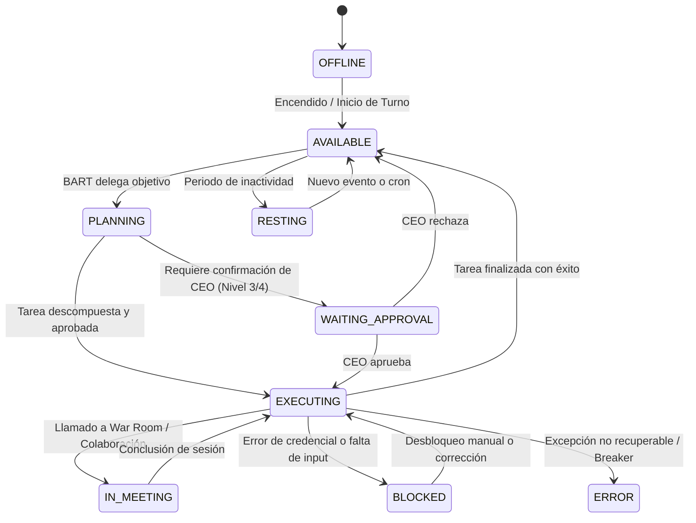
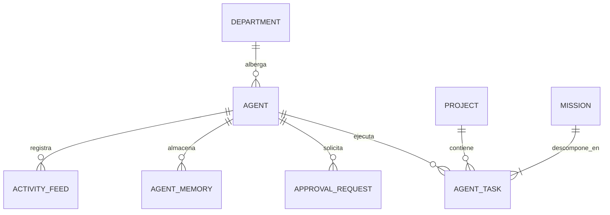

# AI OFFICE HQ — MODELO DE DATOS Y MÁQUINAS DE ESTADO
**Documento:** `AI_OFFICE_DATA_MODEL.md`  
**Fecha:** Noviembre 2026  
**Ecosistema:** MAIN DASHBOARD GG  

---

## 1. Esquema de Entidades Principales

AI OFFICE HQ extiende el esquema estructurado de `db.json` con entidades fuertemente tipadas y validadas con `zod`.

### 1.1. `Agent` (Empleado Digital)
```typescript
interface Agent {
  id: string; // ej: "agent-nexus"
  name: string; // ej: "Nexus (Marketing)"
  role: string; // ej: "Director de Crecimiento & Ads"
  departmentId: string; // ej: "dept-marketing"
  hierarchy: "executive" | "director" | "specialist" | "operative";
  avatar: string; // Emoji o Sprite ID (ej: "🚀")
  genderPresentation: "masc" | "fem" | "tech";
  stationId: string; // ID de cubículo/escritorio asignado (ej: "desk-marketing-01")
  model: string; // ej: "gemini-2.5-flash", "gemini-2.5-pro", "claude-3-7-sonnet"
  autonomyLevel: 1 | 2 | 3 | 4;
  skills: string[]; // ["ad_strategy", "funnel_optimization", "copywriting"]
  tools: string[]; // ["browser_exec", "rag_search", "meta_ads_api"]
  budgetAllowance: {
    dailyDollars: number;
    dailyTokens: number;
    spentDollarsToday: number;
    spentTokensToday: number;
  };
  status: "offline" | "available" | "planning" | "executing" | "waiting_approval" | "blocked" | "error" | "in_meeting" | "resting";
  activeTaskId?: string;
  activeProjectId?: string;
  activeCompany?: string; // ej: "HangOut Panamá", "ARRIVE Agency"
  metrics: {
    tasksCompleted: number;
    successRate: number; // 0 - 100
    avgResponseTimeMs: number;
    totalTokensConsumed: number;
  };
  lastSeen: string; // ISO Date
}
```

### 1.2. `Department` (División Funcional de la Empresa)
```typescript
interface Department {
  id: string; // ej: "dept-marketing"
  name: string; // "Marketing & Crecimiento"
  color: string; // Hex de iluminación ambiental (ej: "#ec4899")
  leadAgentId: string; // "agent-nexus"
  description: string;
  roomCoordinates: {
    gridX: number;
    gridY: number;
    width: number;
    depth: number;
  };
  assignedAgents: string[];
}
```

### 1.3. `AgentTask` (Misión o Subtarea Operativa)
```typescript
interface AgentTask {
  id: string; // ej: "atask-1774350000000"
  parentTaskId?: string; // Tarea padre en descomposición de árbol
  missionId?: string; // ID de la misión global
  title: string;
  description: string;
  projectId?: string;
  companyId?: string;
  assignedAgentId: string;
  delegatedBy: string; // "user" o "agent-bart"
  priorityScore: number; // 0.0 a 10.0
  impactEstimate: number; // Valor económico estimado en USD
  autonomyLevel: 1 | 2 | 3 | 4;
  status: "pending" | "in_progress" | "waiting_approval" | "completed" | "failed" | "cancelled";
  progress: number; // 0 a 100%
  currentStep: string; // Descripción del paso actual en vivo
  deliverables: {
    type: "markdown" | "code" | "file" | "url" | "action";
    title: string;
    content: string;
    createdAt: string;
  }[];
  createdAt: string;
  updatedAt: string;
  completedAt?: string;
}
```

### 1.4. `ApprovalRequest` (Petición de Aprobación al CEO)
```typescript
interface ApprovalRequest {
  id: string; // ej: "appr-1774350000000"
  agentId: string;
  taskId: string;
  actionRequested: string; // ej: "Publicar campaña publicitaria en Meta Ads con $250/día"
  impactEstimate: number;
  autonomyRequired: number; // 3 o 4
  contextData: any;
  status: "pending" | "approved" | "rejected";
  reviewedAt?: string;
  decisionNotes?: string;
  createdAt: string;
}
```

---

## 2. Máquina de Estados Operativos del Agente



---

## 3. Relación entre Entidades


